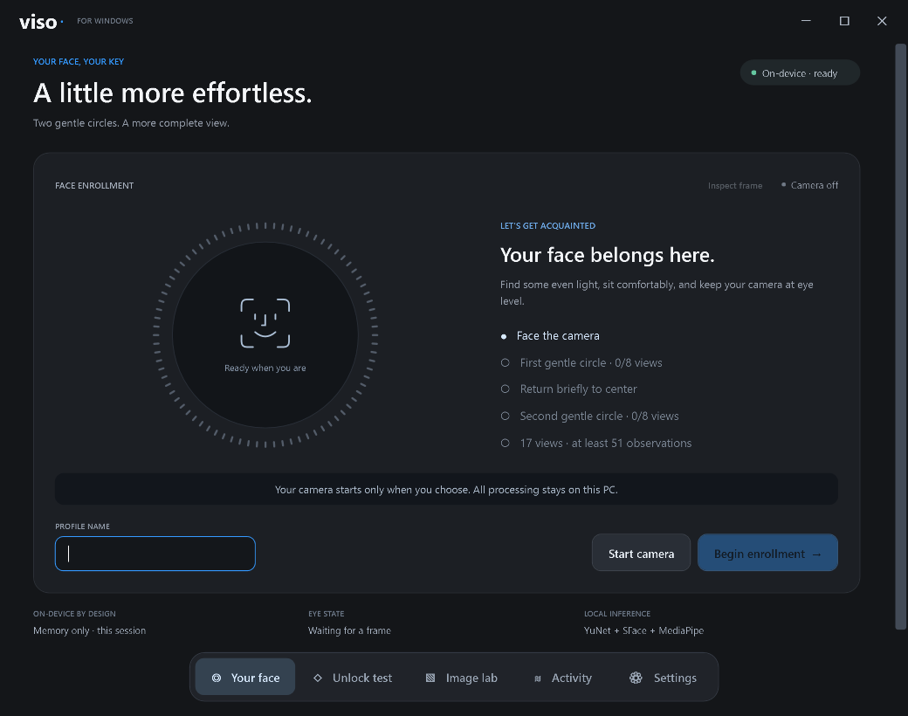
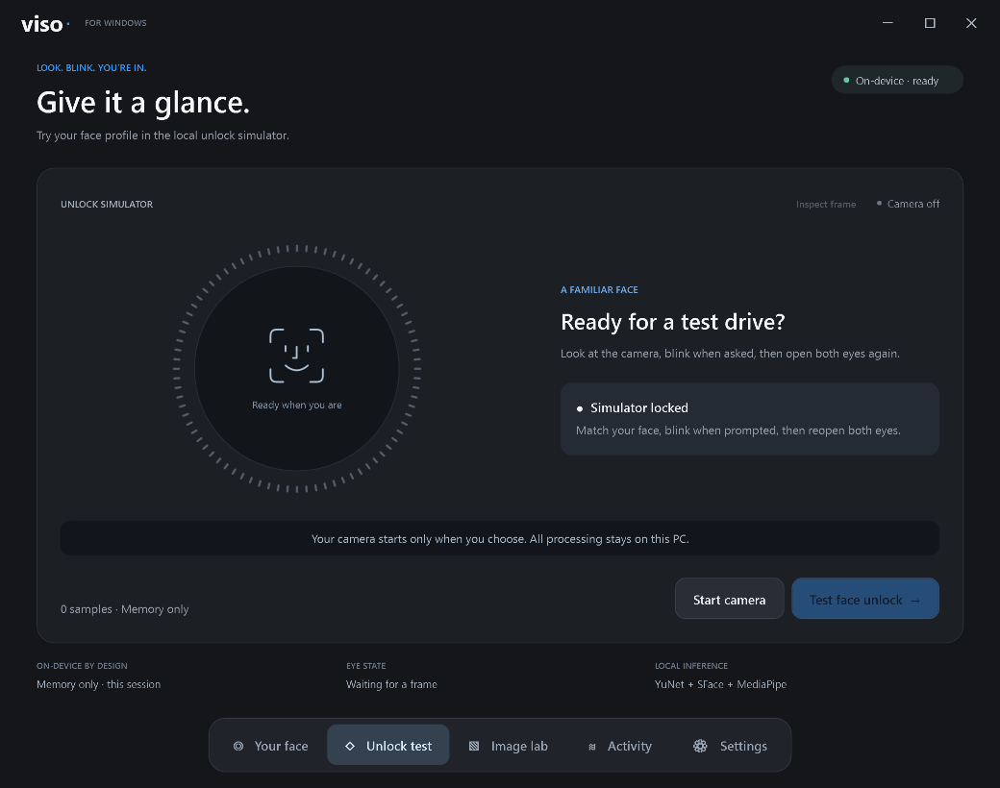

<div align="center">

# viso·

### Look. Blink. You're in.

A native Windows face-recognition experience.<br>Two gentle circles to enroll. A fresh blink to verify. Processing stays on your PC.

[](docs/getting-started.md) [](CHANGELOG.md) [](docs/architecture.md) [](docs/security.md)

[**Download for Windows**](https://github.com/notg0d/viso/releases/tag/v0.8.2) · [**Get started**](#quick-start) · [**Documentation**](docs/README.md) · [**What's new**](CHANGELOG.md)

<br>



<sub>Actual WPF interface, captured by the automated smoke test in memory-only mode. No camera or personal enrollment shown.</sub>

</div>

---

## A little more effortless

Viso pairs a **native C#/WPF desktop** with a local Python recognition worker. Enroll a face, inspect photos, and test identity → prompted blink → reopened-eye confirmation in a focused, Glance-inspired interface. **No Electron, WebView, browser, Node.js, or .NET SDK is needed for the desktop.**

| A more complete view | On-device by design | Native from the start |
| :--- | :--- | :--- |
| Neutral calibration, then two eight-direction circles: **17 averaged views**, at least **51 distinct open-eye observations**. | Recognition runs locally. Keep one DPAPI-encrypted enrollment, or try a memory-only session. | Camera controls, file dialogs, keyboard navigation, measured ring feedback, and reduced-motion support. |

> [!IMPORTANT]
> **Unlock test is a simulator, not the Windows lock screen.** The complete installer additionally installs the experimental Windows sign-in prototype, with explicit consent. Viso uses RGB recognition—not TrueDepth, proven replay protection, or Windows Hello certification. Keep working password/PIN access. [Security and limitations →](docs/security.md)

## Quick start

**[Download the complete Windows x64 installer](https://github.com/notg0d/viso/releases/download/v0.8.2/Viso-0.8.2-Setup-x64.exe)** and its [checksum](https://github.com/notg0d/viso/releases/download/v0.8.2/Viso-0.8.2-Setup-x64.exe.sha256). [Verify the download](docs/releases.md#verify-the-download), close Viso, run Setup and approve its administrator prompt and experimental-sign-in warning. Open Viso from the Start menu as your ordinary Windows user.

Desktop, Python, dependencies, models and sign-in components are included. Requires **Windows 10/11 x64 and .NET Framework 4.8**; Windows on ARM is unsupported. Setup does not enroll faces or collect/link credentials. First-time users enroll and explicitly link their account in Settings. This unsigned **experimental pre-release** has [open installation/authentication validation gates](docs/testing.md#082-complete-installer).

**Desktop only, without a sign-in installation?** The unchanged [v0.8.1 portable ZIP](https://github.com/notg0d/viso/releases/tag/v0.8.1) remains available. Extract the entire archive to a user-writable folder and open `Viso.exe`; no administrator installation is needed. [Downloads, storage, verification and updates →](docs/releases.md)

### Build from source instead

**64-bit Windows 10/11 · .NET Framework 4.8 · Python 3.11+**<br>Development is verified with Python 3.14; compatible wheels are required for the pinned dependencies. Use PowerShell from the repository root.

```powershell
# Create the Python environment, verify/download models, and build the native app
.\scripts\setup.ps1

# Try it without saving an enrollment to disk
.\scripts\start.ps1 -Ephemeral
```

Setup needs internet access; the models total about **43 MB**. Recognition runs locally afterward. The desktop needs **no administrator privileges**.

1. **Enroll** — Open **Your face**, enter a name, and choose **Begin enrollment**. Follow two small circles with both eyes open; recenter only between passes. Blue sectors turn green on the second circle.
2. **Verify** — Open **Unlock test → Test face unlock**. Look at the camera, blink when prompted, and reopen both eyes. Every attempt needs a fresh blink.
3. **Keep it** — Close Viso, then run `.\scripts\start.ps1` without `-Ephemeral` and enroll again to save it. Memory-only enrollment is not carried over.

The source-built executable is `desktop\bin\Viso.exe`; keep it inside the project so it can find the environment and models. The ZIP supports memory-only enrollment with `.\Viso.exe --ephemeral`. Closing Viso releases its camera and worker. [Full walkthrough, photo lab, and controls →](docs/getting-started.md)

## One app. Five focused spaces.

| Space | What it's for |
| :--- | :--- |
| **Your face** | Live preview, camera selection, and guided two-circle enrollment. |
| **Unlock test** | Repeatable local tests with multi-view identity matching and a prompted blink. |
| **Image lab** | Compare up to five reference photos without a webcam. Matching photos still cannot unlock. |
| **Activity** | Review the last 100 session events and export JSON without images or face vectors. |
| **Settings** | Manage enrollment, camera, simulator threshold, reduced motion, and optional account linking. |

<details>
<summary><strong>Preview the unlock simulator</strong></summary>



Automated native UI capture; no live-camera verification is pictured.

</details>

## Optional Windows sign-in

The [v0.8.2 complete installer](https://github.com/notg0d/viso/releases/tag/v0.8.2) includes desktop, private Python/models and Windows sign-in components, with protected upgrade/removal support and matching Windows app/Setup logos. Read the [installer guide](docs/installer.md) before approving installation. Users still enroll and explicitly link their own account from Viso Settings.

The x64 Credential Provider and LocalSystem service can submit a Windows credential after fresh face/blink verification. Local and personal Microsoft accounts are supported by the implementation; **current-build physical authentication, Microsoft-account, multi-user, reboot, and long-sleep validation remain open**.

Installation requires administrator approval; **only source builds** need Visual Studio C++ Build Tools and the Windows SDK. Test in a recoverable environment and keep your ordinary Windows password/PIN sign-in available. Account linking needs the **account password**, not a Hello PIN.

**[Read the complete setup, update, and removal guide →](docs/windows-signin.md)**

Existing five-view profiles remain compatible. For circular coverage, re-enroll and explicitly **Link / update account**; the service retains a snapshot. Desktop **0.8.1** fixes ring rendering only—the installed **0.8.0** sign-in components do not need reinstalling for that hotfix.

## Find your way

| I want to… | Start here |
| :--- | :--- |
| Run Viso or fix a setup problem | [Getting started](docs/getting-started.md) · [Troubleshooting](docs/troubleshooting.md) |
| Understand recognition and data boundaries | [Architecture](docs/architecture.md) · [Security & privacy](docs/security.md) |
| Build, test, or contribute | [Development](docs/development.md) · [Contributing](CONTRIBUTING.md) · [Script index](scripts/README.md) |
| Check evidence, not marketing claims | [Validation](docs/testing.md) · [Measured performance](docs/performance.md) |
| Explore decisions and earlier releases | [Research](docs/enrollment-resume-research.md) · [Project comparison](docs/windows-face-unlock-review.md) · [Changelog](CHANGELOG.md) |

## Repository at a glance

```text
desktop/Viso/         Native C#/WPF application
backend/viso/        Recognition, enrollment, storage, and worker transports
signin/              Optional provider, service, and shared protocol
installer/           Complete Windows Setup and protected deployment/recovery
scripts/             Production setup, build, and deployment entry points
models/manifest.json Pinned model sources and checksums; weights are downloaded
docs/                User guides, technical references, evidence, and history
```

| Branch | Contents |
| :--- | :--- |
| [`main`](https://github.com/notg0d/viso/tree/main) | Production desktop/backend/sign-in/installer sources and shared documentation. Release builds come from clean production commits. |
| [`test`](https://github.com/notg0d/viso/tree/test) | The same production implementation plus regression suites, fixtures/runners, benchmarks, and the isolated [`experiments/browser/`](https://github.com/notg0d/viso/tree/test/experiments/browser) bench. None is a desktop dependency. |

Promote production commits selectively; do not merge test-only content into `main`. [Branch and release workflow →](docs/development.md#branch-and-release-workflow)

Local environments, enrollment data, model weights, and build/test outputs are ignored by Git. [Repository conventions →](docs/development.md#repository-map)

---

<div align="center">

Inspired by [Glance](https://github.com/jonnyoo/glance). Built with YuNet, SFace, and MediaPipe.<br>[Third-party notices](THIRD_PARTY_NOTICES.md) · [Security limitations](docs/security.md) · [Documentation](docs/README.md)

</div>
